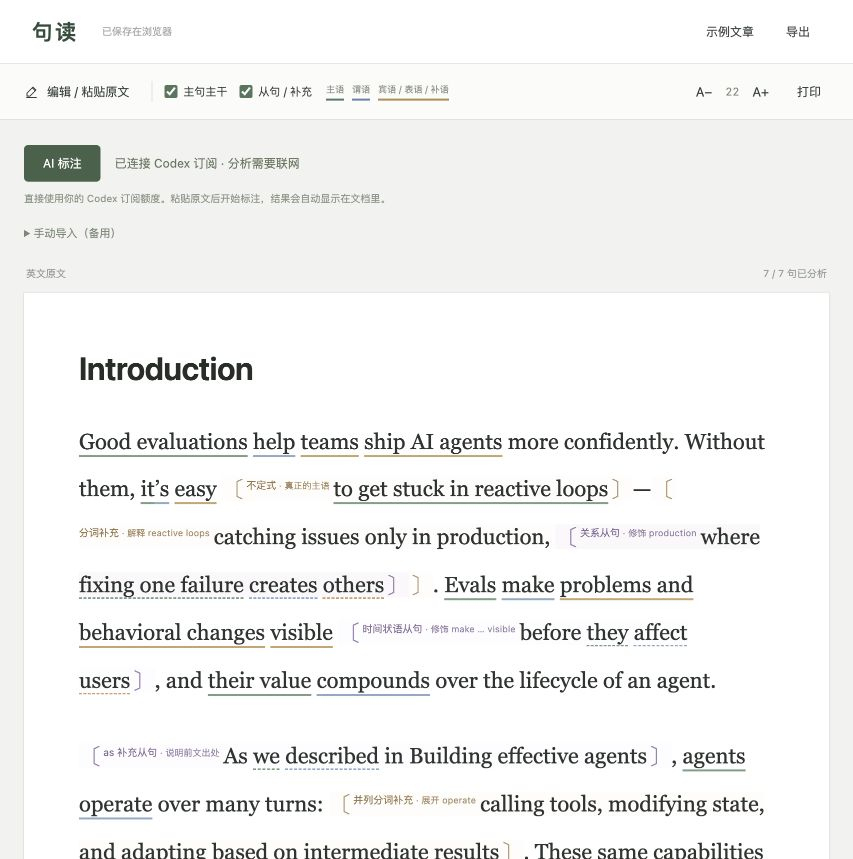

# 句读 · 用自己的 Codex 订阅读英文

句读是一个在本机运行的英文阅读工具。粘贴英文文章，点击「开始标注」，即可在类似 Word 的段落排版中看到句子主干、从句边界和修饰关系。

**每位使用者在自己的电脑上登录自己的 Codex 账号，分析消耗该账号的可用 Codex 额度。** 无需填写 API Key，也无需把文章和分析结果在多个网页间来回复制。项目不提供共享账号或共享额度；账号需要具有相应的 Codex 使用权限和可用模型。



## 能做什么

- 保留完整文章的段落和阅读顺序。
- 用实线标出主句的主语、谓语、宾语或补语，用虚线区分从句内部的成分。
- 用括号和中文标签说明从句边界、修饰对象以及非谓语补充。
- 保留目的状语、动名词、不定式、分词、形式主语等学习长难句需要的具体判断；普通“主语、谓语、宾语”等名称由网页补上，AI 不再默认生成整句翻译和摘要。
- 分批分析，完成一批即显示一批；取消或失败后保留已完成结果。
- 在浏览器保存文章，支持字号调整、打印、JSON 导出和导入。
- 自动保存多篇文章和各自的标注；右上角「历史记录」可搜索、恢复或删除文章，误删可撤销，未完成的标注可继续分析。
- 提供手动导入作为备用，也可直接打开离线 HTML 阅读。

## 准备环境

1. 安装 **Node.js 22 或更新版本**，确认 `node --version` 能显示版本。
2. 按 [OpenAI 官方安装说明](https://learn.chatgpt.com/docs/codex/cli)安装或更新 Codex CLI，确认 `codex --version` 能显示版本。
3. 准备一个具有 Codex 使用权限及剩余额度的 ChatGPT 账号。

本项目已在 macOS 上验证。Linux 可使用下面的命令启动；Windows 建议在 WSL 中安装 Node.js、Codex 并运行项目。Linux / WSL 尚未完成实机验证；`启动句读.command` 仅用于 macOS。

## 克隆后开始使用

### 1. 登录自己的 Codex 账号

登录由使用者电脑上的 **官方 Codex CLI** 管理。句读不提供独立的账号系统，也不会在网页里收集密码、API Key 或登录令牌。克隆代码不会带来作者的登录态。

**先检查是否已经登录：**

```sh
codex login status
```

- 如果显示 `Logged in using ChatGPT`，且你确认这是自己的账号，可以直接进入第 2 步启动项目，无需每次重新登录。
- 如果尚未登录，按下面的首次登录流程操作。
- 如果使用的是 API Key 登录，或不确定当前登录的是谁，按下方「切换账号」操作。

**首次登录：**

1. 在自己的电脑终端运行：

```sh
codex login
```

2. 按照 Codex 提示打开官方登录页面，使用**自己具有 Codex 权限的 ChatGPT 账号**完成登录。若浏览器已登录其他账号，先核对并选择正确账号。
3. 回到终端，等待 Codex 报告登录完成，再检查：

```sh
codex login status
```

4. 确认显示 `Logged in using ChatGPT`，再启动句读。

`login status` 确认的是登录方式，不代表已经验证账号的剩余额度或模型权限。只在浏览器中登录 ChatGPT 网页，也不等于已经登录本机 Codex CLI。

**之后怎样复用登录：**

句读每次启动会调用 `codex login status` 检查状态；分析时调用 `codex exec`，由 Codex 自己使用已保存的凭据。使用同一电脑、同一系统用户和同一 Codex 登录环境时，通常只需登录一次，之后直接运行 `npm start`。分析使用当前登录账号的可用 Codex 额度，不使用项目作者的账号。

**登录失效或切换账号：**

若提示登录失效，重新运行 `codex login` 完成登录，再刷新句读网页。需要切换账号或从 API Key 改用 ChatGPT 登录时，执行：

```sh
codex logout
codex login
codex login status
```

这会退出本机该 Codex 登录环境的原账号，不只是退出句读；随后在官方登录页面选择自己的账号。重新登录后刷新网页，确认出现「已连接 Codex 订阅」。

登录和启动应在同一环境中完成：例如使用 WSL 时，两步都在 WSL 内进行。如果有多个 Codex 版本，或设置过 `CODEX_HOME`，请参照下方「模型与 CLI 配置」保持可执行文件与登录目录一致。不需要将任何凭据文件复制到项目里。

句读通过 `codex exec` 复用本机已保存的登录。本项目要求 ChatGPT 登录方式，不使用 API Key 登录。登录方式与订阅访问的区别见 [官方认证说明](https://learn.chatgpt.com/docs/auth)，脚本调用方式见 [官方非交互模式说明](https://learn.chatgpt.com/docs/non-interactive-mode)。

### 2. 在项目根目录启动

克隆或下载本仓库后，在包含 `package.json` 的文件夹中打开终端：

```sh
npm start
```

项目没有第三方运行依赖，无需先执行 `npm install`，也无需先构建。启动后在浏览器打开：

**[http://127.0.0.1:4173/](http://127.0.0.1:4173/)**

macOS 也可双击项目内的 `启动句读.command`，它会启动服务并打开网页。使用期间保留启动窗口；按 `Control+C` 停止服务。再次使用时重新启动即可。

### 3. 粘贴并标注

1. 确认页面显示「已连接 Codex 订阅」。
2. 点击「编辑 / 粘贴原文」，粘贴英文，段落之间留一个空行。
3. 点击「开始标注」，等待标注逐批显示。只想阅读时可点「仅排版」。
4. 后续点击页面顶部的「AI 标注」，可继续处理未完成的句子。
5. 点击右上角「历史记录」，按标题、保存时间和标注进度找回文章，也可搜索标题或文章开头。每批标注自动更新该文章的记录；粘贴不同文章或导入新文档前，会先保存当前文章。
6. 每篇记录右侧可点击「删除」，删除原文和对应标注。误删时点击列表上方的「撤销」可恢复最近一次删除；刷新页面或再次删除后，前一次删除将不能撤销。删除当前文章也会清空阅读区，避免自动保存把它重新加回历史记录。

升级后，当前浏览器已保存的文章会自动加入历史记录。历史文章保存在该浏览器的 IndexedDB 中，不随本地服务重启丢失，也不会按篇数自动清除；容量由浏览器决定。当前文章正在分析时可查看历史列表，待分析结束或取消后再切换或删除文章。之前已经被覆盖、没有导出的文章无法追溯恢复；清除网站数据或换浏览器后不会自动同步。

分析由本地服务运行，刷新或关闭标签页不会取消任务。在同一个浏览器重新打开页面，会自动接回同一个任务并补回已完成的标注，不会因刷新重复发起分析。只有点击「取消」才主动停止任务。任务恢复记录保存在本地服务内存中（最近 5 次）；如果服务退出或重启，浏览器已保存的标注仍然保留，再点「AI 标注」可继续尚未完成的句子。

「主句主干」与「从句 / 补充」可以分别显示或隐藏。整篇文章最多 **100,000 字符**，粘贴后由程序自动分批，无需手动拆分。AI 的语法判断可能有误，标注用于辅助阅读。

普通文章每批通常处理 **20～30 句**，最多 30 句、8,000 个原文字符；短文章在这个范围内整篇处理。程序保持原文顺序，在尽量减少请求次数的同时均分批次，例如 69 句长度适中的文章分成 23＋23＋23。特别长的句子会减少每批句数；单句超过 8,000 字符时单独处理，不截断。8,000 字符是为标注输出量和等待时间设置的分批预算，不是模型上下文上限，也不影响整篇 100,000 字符的粘贴上限。每批完成后显示并保存结果，因此第一批的等待时间可能比原来的 4 句批次更长；整体速度仍取决于句子复杂度和生成量。

## 账号、额度和数据

调用过程是：浏览器 → 本机 Node.js 服务 → 本机 Codex CLI → OpenAI → 返回标注。

- 每位使用者自行登录；仓库不包含作者的账号、登录凭据或额度。
- 自动分析需要联网，开始标注时会把待分析的英文发送给 Codex。网页本地运行不代表 AI 推理离线运行。
- 文章和标注保存在当前浏览器的本地存储中；切换浏览器或清除网站数据后不会自动同步，重要文章可先导出。
- 服务只监听 `127.0.0.1`。网页不接收密码、API Key 或登录令牌，登录由官方 Codex 客户端处理。
- 分析在临时目录运行，使用只读沙箱并禁用工具、插件和网页搜索；结束后清理项目创建的临时结果。

本工具面向个人电脑使用。GitHub Pages 等静态托管只能提供前端，无法执行每位访问者本机的 Codex；自动分析需要使用者启动自己的本地服务。

## 模型、思考强度与 CLI 配置

默认模型是 `gpt-6.1-sol`，默认思考强度为 **`high`（高）**，并开启 **Fast**。程序每次都显式传入模型、思考强度和 `service_tier="fast"`，同时启用 `fast_mode`。模型是否可用取决于自己的账号、客户端版本与工作区设置，参见 [官方模型说明](https://learn.chatgpt.com/docs/models)。可在启动时配置：

```sh
JUDU_CODEX_MODEL=gpt-6.1-sol JUDU_CODEX_REASONING_EFFORT=high npm start
```

`JUDU_CODEX_MODEL` 指定模型，`JUDU_CODEX_REASONING_EFFORT` 支持 `low`、`medium`、`high`、`xhigh`、`max`，具体取值还需所选模型与 CLI 支持。修改后重启服务，不必修改源码。更高强度通常需要更多时间和额度。为保持标注任务独立，本工具不加载个人 `config.toml`，因此在 Codex 中更改默认模型或强度不会自动改变本工具的请求配置。

底层调用包含以下显式参数（其余沙箱、输出格式等参数省略）：

```sh
codex exec --model gpt-6.1-sol -c 'model_reasoning_effort="high"' --enable fast_mode -c 'service_tier="fast"' ...
```

参数写法见 [官方单次配置说明](https://learn.chatgpt.com/docs/developer-settings#change-settings-for-one-run)。源码中搜索 `CODEX_REQUEST_CONFIG` 可以找到配置与记录位置。

Fast 不改变 `high` 思考强度；可用性取决于模型与账号，订阅内额度按标准速度的 2.5 倍消耗，详见 [官方 Fast 说明](https://learn.chatgpt.com/docs/agent-configuration/speed)。

每批请求会在本地启动窗口打印模型、强度和速度档位，`/api/status` 的 `requestConfig` 也会返回当前配置。新生成的每句标注包含 `generation.requestedModel`、`generation.requestedReasoningEffort`、`generation.requestedServiceTier` 和 `generation.requestedAt`，浏览器保存和 JSON 导出会保留这些字段。它们记录的是**发送给 CLI 的请求配置**，不是服务端实际推理过程的回执。旧标注没有这些字段，表示当时未记录，不能按当前配置补填。

程序依次尝试 `CODEX_CLI_PATH` 指定的可执行文件、macOS ChatGPT 桌面应用附带的 CLI、常见 Homebrew 路径，最后查找 `PATH` 中的 `codex`。仅安装独立 CLI 也可以使用；若安装了多个版本，建议明确指定与登录时相同的可执行文件：

```sh
CODEX_CLI_PATH="$(command -v codex)" npm start
```

以上环境变量写法适用于 macOS、Linux 和 WSL 的 shell。项目不自动加载 `.env` 文件。若自行设置过 `CODEX_HOME`，登录和启动句读时须使用同一值；通常不需要设置。

## 常见问题

| 问题 | 处理方法 |
| --- | --- |
| 页面打不开 | 在项目根目录运行 `npm start`，确认启动窗口没有关闭，然后访问 `http://127.0.0.1:4173/`。 |
| 提示没有 Codex 或尚未登录 | 安装 CLI，执行 `codex login` 和 `codex login status`，再刷新页面。若有多个 CLI，按上节指定路径。 |
| 已登录但仍不能分析 | 检查该账号的 Codex 权限、网络和剩余额度；页面的连接状态只确认登录，不保证模型调用成功。 |
| 提示模型不支持或参数不认识 | 更新 Codex CLI，并用 `JUDU_CODEX_MODEL` 指定账号可用的模型。桌面应用和独立 CLI 可能需要分别更新。 |
| 额度不足 | 等待账号额度恢复后重试；已完成的标注会保留。 |
| 4173 端口被占用 | 同一服务已经运行时可直接打开网页；若是其他程序占用，先停止该程序再启动。 |
| 双击启动文件没有成功 | 在项目文件夹的终端执行 `npm start`，可看到具体错误；确认 Node.js 为 22 或更新版本。 |
| 直接打开 `句读.html` 无法自动分析 | 离线文件支持阅读与手动导入。自动分析请用本地服务地址打开。 |

## 手动导入备用方案

如果暂时无法使用自动标注，可以展开「手动导入（备用）」：

1. 点击「1 复制 GPT 指令」，把指令和英文文章发送到自己使用的 GPT 对话中。
2. 把完整 JSON 结果复制回来，点击「2 粘贴 GPT 结果」导入。
3. 长文可以分批处理：首批带完整原文，后续批次只追加分析，网页会合并到对应句子。

可复制指令见 [给GPT的标注指令.txt](给GPT的标注指令.txt)，示例见 [标注格式示例.json](标注格式示例.json)，详细结构见 [标注格式说明](docs/annotation-format.md)。

## 开发

### 登录相关代码导航（供维护者和 AI 查找）

在源码中搜索 **`CODEX_AUTH_FLOW`**，可定位以下入口：

| 文件 / 函数 | 职责 |
| --- | --- |
| [`codex-bridge.mjs`](codex-bridge.mjs) · `executable()` / `environment()` | 选择本机 CLI、保留登录目录上下文，去除 API Key 和桌面会话相关环境变量。 |
| [`codex-bridge.mjs`](codex-bridge.mjs) · `loginStatus()` | 执行 `codex login status`，确认使用 ChatGPT 登录；不读取凭据文件，不检查剩余额度。 |
| [`codex-bridge.mjs`](codex-bridge.mjs) · `analyzeBatch()` | 通过 `codex exec` 复用本机登录，强制 ChatGPT 登录方式；`--ignore-user-config` 不等于忽略登录态。 |
| [`server.mjs`](server.mjs) · `/api/status` / `/api/analyze` | 向前端提供登录状态、在分析前再次检查登录；返回的 `token` 仅用于本地请求的 CSRF 校验。 |
| [`dist/app.js`](dist/app.js) · `connectAI()` | 展示登录检查结果并控制标注按钮，不在浏览器中执行 Codex 登录。 |

```sh
rg -n CODEX_AUTH_FLOW codex-bridge.mjs server.mjs dist/app.js
```

凭据的保存、使用和登录流程归官方 CLI 管理；本项目只调用 CLI。排查问题时先确认实际使用的 CLI、系统用户、`CODEX_HOME` 和 `codex login status`，不要把用户的凭据读入前端或提交到仓库。

### 测试与构建

```sh
npm test       # 验证原文保护、标注格式、分批合并和本地接口
npm run build  # 在项目根目录重新生成离线 HTML、GPT 指令和格式示例
```

```text
.
├── README.md                 使用说明
├── package.json              启动、测试和构建命令
├── 启动句读.command           macOS 启动入口
├── server.mjs                本地网页与分析接口
├── codex-bridge.mjs          调用本机 Codex CLI
├── ai-format.mjs             AI 指令、输出结构与分批规则
├── dist/                     网页源码和内置示例
├── test/                     自动化测试
├── docs/                     标注格式说明与界面预览
├── build-local.mjs           离线页面打包脚本
├── 句读.html                 可直接打开的离线版本
├── 给GPT的标注指令.txt         手动分析提示词
└── 标注格式示例.json           可导入的示例
```

修改 `dist/` 后，本地服务刷新页面即可加载；提交前运行 `npm run build` 同步离线版本。所有构建产物都位于本项目文件夹中，不依赖作者电脑上的目录。
